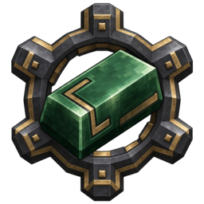
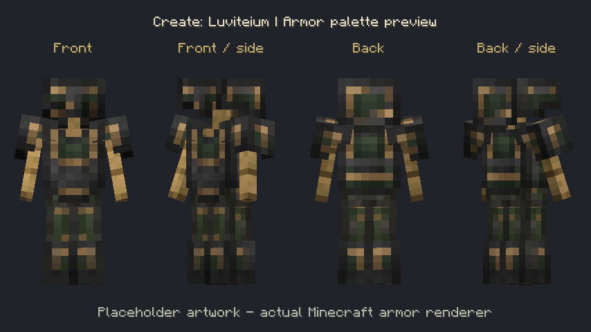
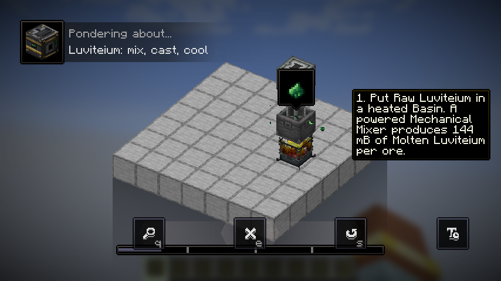
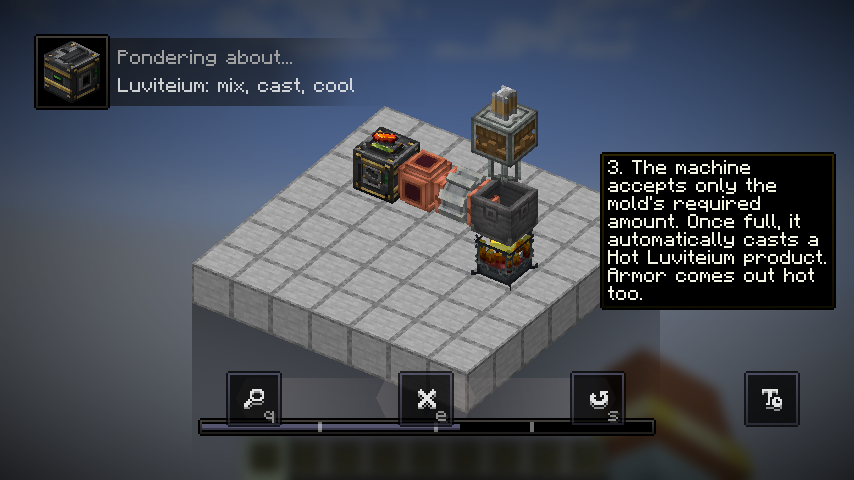
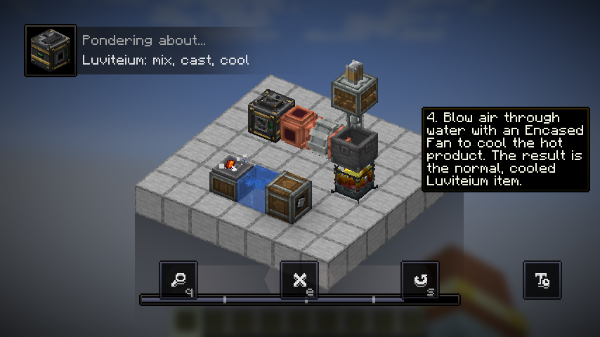
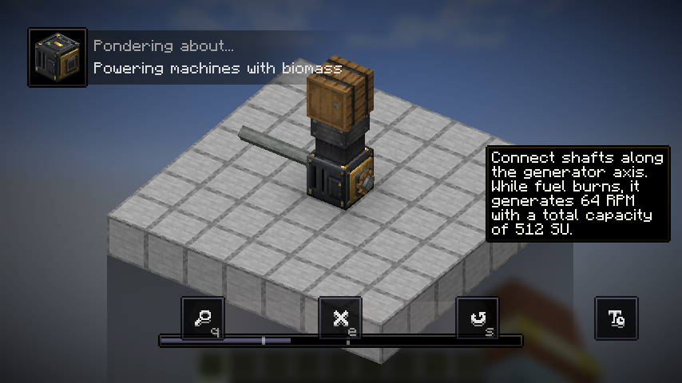
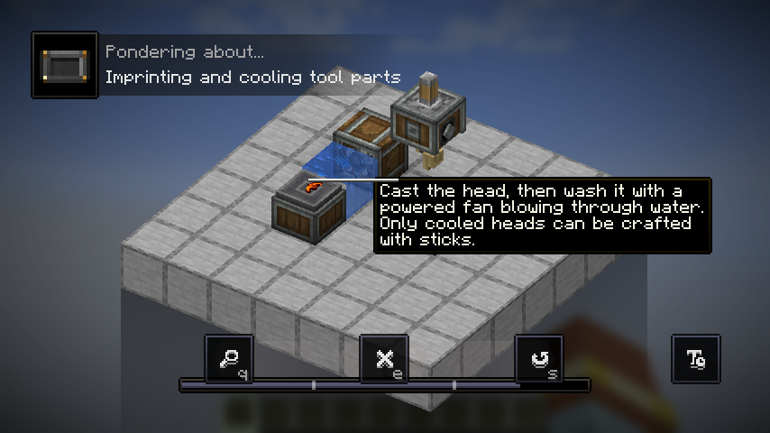

<p align="center">
  
</p>

# Create: Luviteium

**Melt ore. Cast parts. Build with Create.**

Create: Luviteium is a Minecraft addon that brings a rare green metal, reusable
casting molds and biomass-powered machinery to Create. Turn raw Luviteium into
molten metal, cast it into hot components, then cool and assemble your equipment.

**Status: released · 1.1.1.**

This repository contains the 1.1.1 release line. Recipes, balance and visuals may
change in future releases.


*An in-game preview of casting. The artwork shown is temporary.*

## Features

- **Luviteium ore and equipment:** a new material with five tools, a full armor
  set, pressed panels and a storage block.
- **Mold-based casting:** ten reusable molds for ingots, tool heads, a sword
  blade and armor pieces. The Casting Machine accepts exactly the molten metal
  required by its mold, with the installed mold displayed on its sides.
- **Create automation:** heated mixing, fluid pipes, Deployer mold imprinting,
  fan cooling and mechanical pressing form one production chain.
- **Biomass power:** a fuel-burning generator supplies **64 RPM / 512 SU** and
  accepts automated fuel input through a Chute.
- **Working machine animations:** visible molds and molten fill, a short product
  ejection animation, rotating generator drive wheels and combustion smoke.
- **In-game guidance:** three Ponder tutorials, with English and Turkish text.
- **Languages:** English (US), English (UK), Türkçe and Deutsch.

<details>
<summary>Armor preview (placeholder artwork)</summary>



The current armor palette uses dark metal, aged brass and muted green accents.

</details>

## In-game gallery

These screenshots come from the animated Ponder scenes. The screenshots show the
current placeholder art and are included to make the processing flow easy to scan.

<table>
  <tr>
    <td></td>
    <td></td>
  </tr>
  <tr>
    <td align="center">Heated mixing</td>
    <td align="center">Hot casting</td>
  </tr>
  <tr>
    <td></td>
    <td></td>
  </tr>
  <tr>
    <td align="center">Fan cooling</td>
    <td align="center">Biomass power</td>
  </tr>
</table>

<details>
<summary>Blank Mold and Deployer tutorial</summary>



</details>

## Requirements and installation

The 1.1.1 release build is tested with:

| Component | Version |
| --- | --- |
| Minecraft | 1.21.1 |
| Mod loader | NeoForge 21.1.229 |
| Create | 6.0.10 |
| Java | 21 |

1. Set up a Minecraft 1.21.1 instance with NeoForge and the matching Create mod.
2. [Build the Luviteium JAR](#build-from-source) and place it in the instance's
   `mods` folder. Keep only one version of Luviteium installed.
3. Start Minecraft. For multiplayer, install the mod and its required
   dependencies on both the client and server.

These are the verified versions; compatibility with other Minecraft versions or
mod loaders has not been established.

## From ore to equipment

1. **Melt:** put Raw Luviteium in a Basin heated by a fueled Blaze Burner. A
   powered Mechanical Mixer converts each raw item into **144 mB of Molten Luviteium**.
2. **Prepare a mold:** place a Blank Mold on a Depot and use a powered Deployer
   holding the corresponding sample item. The sample is consumed; tools and
   armor samples must be undamaged. The resulting mold is reusable.
3. **Cast:** insert the mold into a Casting Machine and pump in molten metal.
   Once the required amount arrives, the machine produces a hot item.
4. **Cool:** use a powered Encased Fan blowing **through water** onto the hot
   item on a Depot or belt. Every cast, including armor, needs this cooling step.
5. **Assemble:** craft one cooled tool head with two sticks, or one cooled sword
   blade with one stick. Cooled armor is ready to equip. Ingots can also be
   be pressed with Create's Mechanical Press into Luviteium Panels, or crafted
   into storage blocks.

Hover over a **Casting Machine**, **Blank Mold** or **Biomass Generator** and
hold the Ponder key (default **W**) for an animated walkthrough.

See the [processing guide](docs/processing.md) for quantities and casting times,
or the [mold reference](docs/molds.md) for sample items.

## Development status

The current release passes eleven Minecraft GameTests covering production, equipment,
generator behavior and animation synchronization. Client checks also play and
replay all three Ponder scenes and verify machine rendering.

A complete survival automation line and extended multiplayer gameplay still need
further testing. The [QA notes](docs/qa-report.md) and
[implementation history](docs/implementation-status.md) describe coverage and
remaining checks. Artwork remains provisional; see the
[texture notes](docs/textures.md) for provenance and replacement guidance.

## Build from source

Install a **Java 21 JDK**, clone this repository and run from its root:

```sh
./gradlew build
```

On Windows, use `gradlew.bat build`. The included Gradle Wrapper downloads the
required build tools and dependencies on first use; a separate Gradle installation
is not needed. The mod JAR is written to `build/libs/`.

To run the development client:

```sh
./gradlew runClient
```

To run automated checks:

```sh
./gradlew build runGameTestServer
./gradlew runClient -PponderSmokeTest
```

The Ponder check requires a graphical desktop. It creates a disposable flat world,
captures screenshots in `runs/client/screenshots/` and exits automatically.
See [animation documentation](docs/animations.md) for the current render checks.

## Reporting issues

Include your Minecraft, NeoForge, Create and Luviteium versions, steps to reproduce
the problem, and the relevant log or crash report. Screenshots help with visual
issues. Remove personal information from logs before sharing them.

## License

Create: Luviteium is available under the [MIT License](LICENSE).
